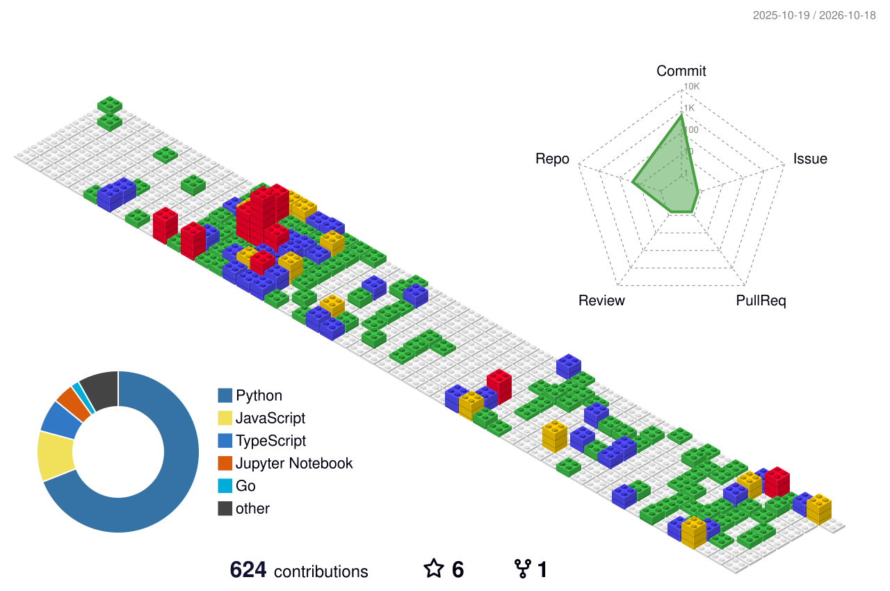

<div align="center">



<a href="https://github.com/Sandesh30-cloud">
  
</a>

<br/>


</div>

---

## ⟦ 01 ⟧ IDENTITY MATRIX

```text
╔══════════════════════════════════════════════════════════════════╗
║  ◉ NAME       : Sandesh Yesane                                   ║
║  ◉ ROLE       : Software Engineer / AI-ML Engineer               ║
║  ◉ EDUCATION  : B.E. Computer Engineering, Univ. of Mumbai       ║
║                 (2022 – 2026)                                    ║
║  ◉ FOCUS      : ML & NLP │ GenAI (LangChain, RAG, Multi-Agent)   ║
║                 Full Stack │ IoT & Embedded                      ║
║  ◉ OPEN TO    : Entry-level AI/ML │ SDE roles │ Open source      ║
╚══════════════════════════════════════════════════════════════════╝
```

---

## ⟦ 02 ⟧ TECH ARSENAL

<div align="center">

**`LANGUAGES`**


**`GEN AI`**


`Prompt Engineering` · `LLM Fine-Tuning` · `Agents & Tool Use`

**`MACHINE LEARNING`**


`matplotlib` · `Deep Learning` · `NLP` · `Time-Series` · `Feature Engineering` · `EDA`

**`FRONTEND`**


**`BACKEND`**


**`CLOUD · DB · DEVOPS`**


`CI/CD`

</div>

---

## ⟦ 03 ⟧ NEURAL TRAINING STATUS

```text
 AGENTIC_AI      ▐███████████████░░░░░▌  70%
 RAG_LLM_APPS    ▐███████████████░░░░░▌  70%
 SYSTEM_DESIGN   ▐██████████░░░░░░░░░░▌  50%
```

**🎓 Certifications:** `IBM Data Fundamentals` · `Data Science, Machine Learning & NLP` · `AWS Cloud Essentials`

---

## ⟦ 04 ⟧ 3D CONTRIBUTION GRID

<div align="center">



</div>

---

## ⟦ 05 ⟧ GITHUB TELEMETRY

<div align="center">


</div>

---

## ⟦ 06 ⟧ DEPLOYMENT PIPELINE


---

## ⟦ 07 ⟧ OPEN COMMS CHANNEL

<div align="center">

[](mailto:sandeshyesane996@gmail.com)
[](https://linkedin.com/in/sandesh-yesane-644396259)
[](https://leetcode.com/u/Lazy_Coder04)
[](https://sandesh-yesane-pi.vercel.app)
[](https://github.com/Sandesh30-cloud)

<br/>

<a href="https://github.com/Sandesh30-cloud">
  
</a>


</div>
