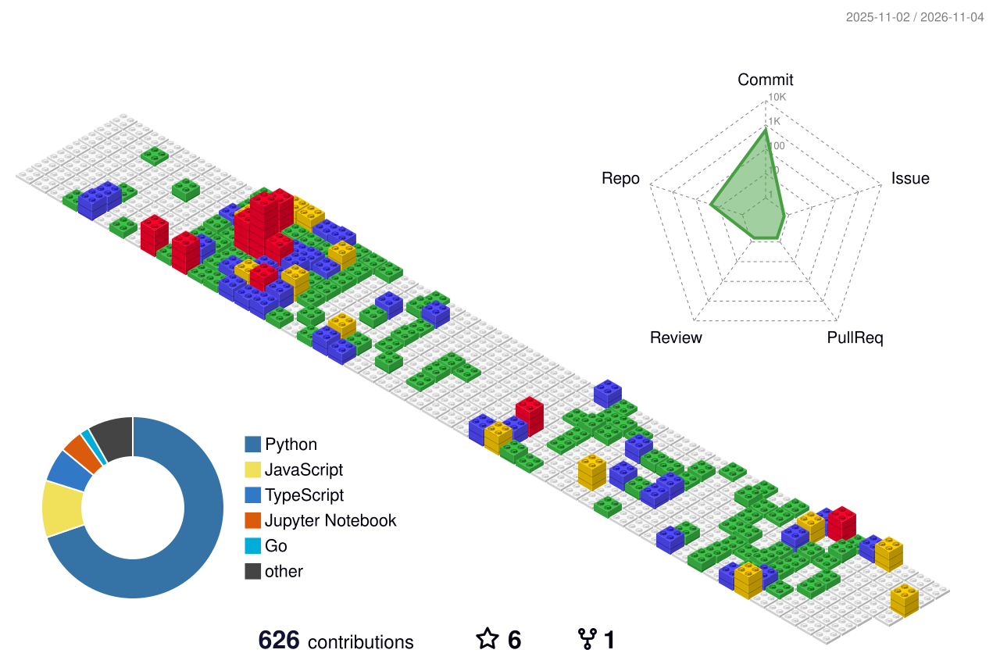

 

**I build AI systems that work end to end: from raw data and sensors to agents, APIs, and dashboards.**

 

---

## 👋 About

I'm a Computer Engineering graduate (VCET, 2026) and **ML Engineering Intern at FlyRank AI**, where I train and compare classification models on search-ranking data.

Outside work I build things end to end:

- 🤖 **Multi-agent LLM pipelines** and RAG applications with LangChain
- 🌊 **Real-time IoT + ML systems** that turn sensor data into decisions
- 📈 **Full-stack apps** with FastAPI and Next.js

📍 Mumbai, India &nbsp;·&nbsp; 🎯 Open to ML / AI roles and collaborations

---

## 🧊 Contributions in 3D

---

## 🚀 Featured Projects

<table>
  <tr>
    <td width="33%" valign="top">
      <h3>🌊 AquaSense Edge</h3>
      <b>IoT · Computer Vision · Deep Learning</b>
      
Real-time aquaculture monitoring across <b>5+ parameters</b> with a live dashboard. Switching to AprilTag-based fish-length estimation cut calibration time by <b>70%</b>, and an RNN flags anomalies early.

      ESP32 · Raspberry Pi · Python · RNN
    </td>
    <td width="33%" valign="top">
      <h3><a href="https://github.com/Sandesh30-Cloud/AgenticResearch">🧠 AgenticResearch</a></h3>
      <b>LLM Agents · Automation</b>
      
Four coordinated agents (<b>Search, Reader, Writer, Critic</b>) turn a live web search into a finished report, with a Streamlit dashboard to monitor every agent.

      LangChain · Tavily · BeautifulSoup · Streamlit
    </td>
    <td width="33%" valign="top">
      <h3><a href="https://github.com/Sandesh30-Cloud/StockAnalyzer">📈 StockAnalyzer</a></h3>
      <b>Full-stack · NLP · Backtesting</b>
      
SMA20/50 trend analysis, Buy/Sell/Hold signals, news sentiment, and an SMA/RSI backtester reporting returns, <b>max drawdown</b>, and win rate.

      FastAPI · Next.js · TypeScript · Python
    </td>
  </tr>
</table>

---

## 🛠️ Tech Stack

  

  

**Also:** LangChain · LlamaIndex · ChromaDB · Hugging Face · Keras · Pandas · NumPy · Power BI · Streamlit · RAG · Prompt Engineering

---

## 💼 Experience

| When | Role | What I did |
| --- | --- | --- |
| **Jul – Aug 2026** | **ML Engineering Intern**, FlyRank AI | Engineered features from anonymized search-ranking data and compared Logistic Regression, Decision Tree, and Random Forest models to flag pages needing a content refresh. |
| **Dec 2023 – Jan 2024** | **Web Development Intern**, Prodigy Infotech | Built and deployed 5+ responsive web apps (HTML, CSS, JavaScript, REST APIs) tested across 3+ browsers and devices. |

## 🏅 Certifications

IBM Data Fundamentals &nbsp;·&nbsp; Udemy: Data Science, ML, DL & NLP &nbsp;·&nbsp; AWS Cloud Practitioner Essentials

---

**Let's build something together.** &nbsp; [Portfolio](https://sandesh-yesane-pi.vercel.app) · [LinkedIn](https://www.linkedin.com/in/sandeshyesane) · [Email](mailto:sandeshyesane996@gmail.com)

